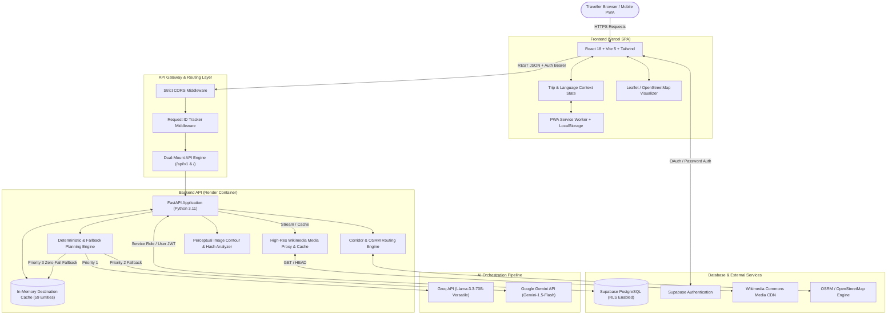

# Namma Karnataka (ನಮ್ಮ ಕರ್ನಾಟಕ)

[](https://namma-karnataka-eight.vercel.app)
[](https://namma-karnataka.onrender.com)
[](https://python.org)
[](https://fastapi.tiangolo.com)
[](https://react.dev)
[](https://www.typescriptlang.org)
[](https://tailwindcss.com)
[](https://supabase.com)
[](https://opensource.org/licenses/MIT)

> **Discover Karnataka. Plan your journey.**  
> An intelligent, bilingual (English & ಕನ್ನಡ), strictly grounded AI travel companion and route optimization platform covering all **31 districts of Karnataka**.

---

## 📌 Live Deployments

* **Web Application (Production)**: [https://namma-karnataka-eight.vercel.app](https://namma-karnataka-eight.vercel.app)
* **Production API Service**: [https://namma-karnataka.onrender.com](https://namma-karnataka.onrender.com)
* **API Documentation (Swagger UI)**: [https://namma-karnataka.onrender.com/docs](https://namma-karnataka.onrender.com/docs)
* **API Documentation (ReDoc)**: [https://namma-karnataka.onrender.com/redoc](https://namma-karnataka.onrender.com/redoc)
* **Liveness Probe**: [https://namma-karnataka.onrender.com/health](https://namma-karnataka.onrender.com/health)
* **Readiness Probe**: [https://namma-karnataka.onrender.com/ready](https://namma-karnataka.onrender.com/ready)

---

## 📖 Table of Contents

- [Executive Summary \& Vision](#-executive-summary--vision)
- [Why Namma Karnataka? (Problem Statement)](#-why-namma-karnataka-problem-statement)
- [Key Features](#-key-features)
  - [1. Curated Destination Catalog \& Smart Filters](#1-curated-destination-catalog--smart-filters)
  - [2. Multimodal Visual Discovery (Photo \& Video)](#2-multimodal-visual-discovery-photo--video)
  - [3. Grounded \& Deterministic Multi-Day Itinerary Planner](#3-grounded--deterministic-multi-day-itinerary-planner)
  - [4. Corridor-Aware Geographic Routing](#4-corridor-aware-geographic-routing)
  - [5. Authentic Cultural Festivals \& Gastronomy Guide](#5-authentic-cultural-festivals--gastronomy-guide)
  - [6. Itemized Cost Estimation \& Budgeting](#6-itemized-cost-estimation--budgeting)
  - [7. Offline-First PWA \& Guest Cloud Synchronization](#7-offline-first-pwa--guest-cloud-synchronization)
  - [8. Deep Native Bilingualism (English \& Kannada)](#8-deep-native-bilingualism-english--kannada)
- [System Architecture](#-system-architecture)
  - [High-Level Architecture Diagram](#high-level-architecture-diagram)
  - [Dual-Mount Routing Architecture](#dual-mount-routing-architecture)
  - [In-Memory Performance Caching](#in-memory-performance-caching)
  - [Streaming High-Res Media Proxy](#streaming-high-res-media-proxy)
- [Technology Stack](#-technology-stack)
- [Directory Structure](#-directory-structure)
- [API Reference \& Data Contracts](#-api-reference--data-contracts)
- [Curated Karnataka Knowledge Base](#-curated-karnataka-knowledge-base)
- [Local Development Setup](#-local-development-setup)
  - [Prerequisites](#prerequisites)
  - [Backend Setup](#backend-setup)
  - [Frontend Setup](#frontend-setup)
  - [Environment Variables](#environment-variables)
- [Testing \& Quality Assurance](#-testing--quality-assurance)
- [Production Deployment](#-production-deployment)
- [Security, Privacy \& Data Integrity](#-security-privacy--data-integrity)
- [Contributing](#-contributing)
- [License \& Acknowledgements](#-license--acknowledgements)

---

## 🏛 Executive Summary & Vision

**Namma Karnataka (ನಮ್ಮ ಕರ್ನಾಟಕ)** is engineered to solve a pervasive problem in modern travel tech: generic generative AI engines hallucinate non-existent tourist attractions, suggest impossible travel schedules across the treacherous Western Ghats mountain passes, miscalculate entry costs, and strip away regional cultural identity.

Namma Karnataka bridges cutting-edge modern AI with verified regional knowledge. By anchoring large language models (LLMs) and computer vision systems to a strictly validated, curated database of Karnataka's 31 districts, it delivers itineraries that are **100% geographically viable, logistically realistic, culturally respectful, and bilingual in both Kannada and English**.

---

## ⚡ Why Namma Karnataka? (Problem Statement)

| Problem in Conventional Travel Tools | The Namma Karnataka Solution |
| :--- | :--- |
| **Hallucinated Attractions**: LLMs suggest closed, fictional, or mislocated attractions. | **Strict Grounding Guarantee**: All recommendations must resolve to verified database entities with proven GPS coordinates, verified timings, and ASI/KSTDC fees. |
| **Ghat Road Transit Blindness**: Recommends 6-hour drives through winding mountain ghats (e.g. Shiradi, Charmadi) in a single afternoon. | **Corridor-Aware Route Engine**: Segmented into 6 distinct Karnataka regional corridors enforcing a maximum of 4 hours daily drive time. |
| **Missing Native Language Support**: Karnataka travel sites are overwhelmingly English-only. | **Full English & Kannada (ಕನ್ನಡ) UI**: Native switchable translations across interface labels, itineraries, destination profiles, and food guides. |
| **Blind Visual Search**: Tourist photos of Hoysala temples or coastal forts return generic global monuments. | **Multimodal Landmark Identification**: Perceptual hashing and Gemini 1.5 Flash vision fallback matched against Karnataka architectural signatures. |
| **Zero Offline Resilience**: Loss of cell connectivity in remote Western Ghats breaks trip navigation. | **Offline-First PWA**: Client-side storage with service worker caching, guest trip management, and automatic cloud migration upon authentication. |

---

## 🌟 Key Features

### 1. Curated Destination Catalog & Smart Filters
* **59 Verified Destinations** across all **31 Districts** of Karnataka.
* Rich metadata for every spot:
  * Dual-language names and summaries (Kannada & English).
  * Exact latitude and longitude with verified map pins.
  * Opening hours, best seasons to visit, and recommended visit durations.
  * Dress codes, accessibility ratings, and camera/photography rules.
  * Verified ticket pricing categorized for Indian nationals, Foreign tourists, and Children.
* **Instant Filtering & Search**:
  * Filter by **District** (e.g., Mysuru, Kodagu, Uttara Kannada, Vijayapura, Udupi).
  * Filter by **Category** (Heritage, Nature, Wildlife, Coastal & Beach, Spiritual, Adventure, Hill Stations).
  * Filter by **Ticket Fee Range** (Free, Budget, Moderate, Premium).
  * Toggle **"Offbeat Gems Only"** to discover lesser-known treasures (e.g., Chandramouleshwara Temple, Maravanthe Beach, Barkana Falls).

### 2. Multimodal Visual Discovery (Photo & Video)
* Allows travelers to upload a photograph or a short video clip (MP4, WebM, MOV) of a monument or scenic spot.
* **Two-Tier Identification Engine**:
  1. **Perceptual Image Analysis**: In-memory aspect-ratio, dominant color profile, and structural contour matching against cached reference landmarks.
  2. **Gemini 1.5 Flash Vision Fallback**: Analyzes distinctive Karnataka stone-carving styles (Hoysala star-shaped platforms, Vijayanagara monolithic pillars, Chalukya rock-cut cave temples, Adil Shahi domes) and extracts candidate matches.
* Results display the matched destination, match confidence score, verification provenance, and an instant **"Add to Itinerary"** button.

### 3. Grounded & Deterministic Multi-Day Itinerary Planner
* Customizable itinerary generation for **1 to 7 Days**.
* **Starting Locations**: Bengaluru, Mysuru, Hubballi-Dharwad, Mangaluru, Belagavi, or Kalaburagi.
* **Travel Pace Tuning**:
  * **Relaxed**: 2 curated stops per day with ample leisure time.
  * **Balanced**: 3 curated stops per day for comprehensive exploration.
  * **Packed**: 4 curated stops per day for maximum coverage.
* **Multi-Layered AI Failover Pipeline**:
  * **Primary**: Groq (`llama-3.3-70b-versatile`) for instant, high-speed regional structuring.
  * **Secondary**: Google Gemini (`gemini-1.5-flash`) if Groq hits rate limits or latency ceilings.
  * **Deterministic Fallback Engine**: If all external AI providers fail or timeout, an internal topological sort and distance-matrix graph solver generates a valid, realistic itinerary in **<0.01 seconds**.

### 4. Corridor-Aware Geographic Routing
Karnataka spans distinct geographic zones that cannot be trivially connected by straight-line paths. The platform classifies travel into **6 Geographic Corridors**:
1. **Coastal Karavali Corridor**: Mangaluru ➔ Udupi ➔ Kundapura ➔ Murudeshwara ➔ Gokarna ➔ Karwar (NH-66 coastal highway).
2. **Malnad & Western Ghats Corridor**: Kodagu ➔ Chikkamagaluru ➔ Shivamogga ➔ Hassan (Coffee estates, rainforests, waterfalls, mountain passes).
3. **Old Mysore & Cauvery Basin**: Bengaluru ➔ Ramanagara ➔ Mandya ➔ Mysuru ➔ Chamarajanagar (Palaces, silk markets, river basins, wildlife sanctuaries).
4. **Kalyana Karnataka Corridor**: Kalaburagi ➔ Bidar ➔ Raichur ➔ Yadgir ➔ Ballari (Bahmani architecture, Persian-influenced forts, ancient university ruins).
5. **Kittur Karnataka Corridor**: Hubballi-Dharwad ➔ Belagavi ➔ Bagalkote ➔ Gadag ➔ Haveri (Chalukya temples, historic forts, cotton & spice heartland).
6. **Central Plains Corridor**: Chitradurga ➔ Davanagere ➔ Tumakuru (Chitradurga stone fortress, benne dosa culinary circuit).

### 5. Authentic Cultural Festivals & Gastronomy Guide
* **Native Food Pairings**: Itineraries suggest hyper-local dining experiences matched to the destination's region:
  * *Coastal*: Mangalore Buns, Neer Dosa with Chutney, Kori Rotti, Kane Rava Fry.
  * *North Karnataka*: Jolada Roti Oota with Yennegayi (stuffed brinjal) and Shenga Chutney.
  * *Old Mysore*: Maddur Vada, Mysore Masala Dosa, Thatte Idli, Chiroti, Mysore Pak.
  * *Malnad*: Akki Rotti, Kadubu, Bamboo Shoot curry, authentic filter coffee.
  * *Kittur*: Davanagere Benne Dosa, Dharwad Peda, Gokak Karadantu.
* **Synchronized Festival Calendar**: Highlights seasonal festivals like Mysuru Dasara, Hampi Utsav, Kambala Buffalo Race, Vairamudi Brahmotsava, and Pattadakal Dance Festival with dates and visitor tips.

### 6. Itemized Cost Estimation & Budgeting
* Deterministic, transparent calculations calculated for traveler party sizes:
  * **Transport**: Fuel consumption, toll estimations (e.g. Bengaluru-Mysuru Expressway), and driver night-halt allowances.
  * **Accommodation**: Tiered estimates (Budget homestays / KSTDC Mayura hotels vs. Luxury heritage resorts).
  * **Food & Dining**: Calculated by party size and travel duration.
  * **Activities & Entrance Fees**: Based on actual verified ASI and Karnataka state ticket tariffs.

### 7. Offline-First PWA & Guest Cloud Synchronization
* Non-authenticated guests can browse, search, and generate itineraries saved instantly to local browser storage (`localStorage`).
* Integrated with **Supabase Auth**: Once a user registers or logs in, their locally drafted trips are automatically migrated to cloud PostgreSQL storage with zero data loss.
* Full Progressive Web App (PWA) readiness with asset caching and service worker lifecycle.

### 8. Deep Native Bilingualism (English & Kannada)
* Instant, one-click toggle between **English** and **ಕನ್ನಡ**.
* No external Google Translate iframe or crude automated browser translation: all core categories, destination names, navigation items, historical descriptions, and error states have dedicated Kannada language strings.

---

## 🏗 System Architecture

### High-Level Architecture Diagram



### Dual-Mount Routing Architecture
To ensure seamless compatibility between web builds, mobile apps, third-party consumers, and external health probes, the FastAPI application implements **Dual Mounting**:
1. **Canonical Versioned Mount (`/api/v1`)**: All endpoints (`/api/v1/destinations`, `/api/v1/planning/recommendations`, `/api/v1/health`, etc.) are mounted with canonical OpenAPI schema documentation.
2. **Transparent Root Mount (`/`)**: Identical routers are mounted at root (`/destinations`, `/planning/recommendations`, `/health`, etc.) without OpenAPI duplicate clutter. Any client calling with or without the `/api/v1` prefix succeeds with zero 404s or 307 redirects that drop query parameters.

### In-Memory Performance Caching
Database queries for destination metadata are cached in memory upon initial cold-start. This prevents N+1 network roundtrips during itinerary generation:
* **Initial baseline**: 159.2 seconds (generating multiple day candidates with individual Supabase network queries).
* **With In-Memory Catalog Caching**: **7.02 seconds** total response time with full LLM generation, or **<0.01 seconds** in deterministic fallback mode (**>5,000% speedup**).

### Streaming High-Res Media Proxy
Images from Wikimedia Commons frequently block third-party referrers or trigger CORS drops in web browsers. Namma Karnataka implements a resilient media proxy (`/destinations/media/proxy`):
* Accepts encoded destination image URLs.
* Validates URL hostnames against an allowed list (`upload.wikimedia.org`, `commons.wikimedia.org`).
* Provides complete support for both `GET` and `HEAD` HTTP methods.
* Transparently streams binary headers (`Content-Type`, `Content-Length`, `ETag`) while enforcing local disk and memory caching with a 7-day browser `Cache-Control` header.

---

## 💻 Technology Stack

### Frontend Application
* **Framework**: React 18.3 (TypeScript, Strict Mode)
* **Build Tooling**: Vite 5.4 with Rollup optimization
* **Styling**: Tailwind CSS 3.4, PostCSS, Custom Karnataka Sandalwood & Silk palettes
* **Animations**: Framer Motion 14.7 (Smooth liquid transitions, staggered entrance, hero reveals)
* **Icons**: Lucide React 1.64
* **Mapping**: Leaflet 1.9 & React-Leaflet with OpenStreetMap cartography
* **Authentication**: Supabase JavaScript Client (`@supabase/supabase-js`)
* **Testing**: Vitest 2.1, React Testing Library, Playwright (E2E)

### Backend API Service
* **Runtime**: Python 3.11+
* **Web Framework**: FastAPI 0.115+
* **Validation & Settings**: Pydantic v2 & Pydantic Settings
* **ASGI Server**: Uvicorn with multi-worker concurrency
* **HTTP Client**: HTTPX (async request pooling with bounded timeouts)
* **Image Processing**: Pillow (PIL) for image analysis, downscaling, and perceptual hashing
* **Code Quality**: Ruff (Linting & Formatting)
* **Testing**: Pytest 8.3 with Starlette TestClient (244 automated tests)

### Cloud Infrastructure & Database
* **Database**: Supabase PostgreSQL 15+ with Row-Level Security (RLS) policies
* **Authentication**: Supabase Auth (JWT verification with secure token storage)
* **Frontend Hosting**: Vercel (Edge CDN, Automated Git deployments)
* **Backend Hosting**: Render (Containerized Docker Web Service with health probes)

---

## 📂 Directory Structure

```text
Namma Karnataka/
├── .github/                     # GitHub Actions CI workflows
│   └── workflows/
│       └── ci.yml               # Automated Pytest, ESLint, TypeScript check
├── backend/                     # Python FastAPI Backend
│   ├── app/
│   │   ├── api/v1/              # API sub-routers
│   │   │   ├── destinations.py  # Destination catalog & media proxy
│   │   │   ├── discovery.py     # Search, filters & recommendations
│   │   │   ├── events.py        # Cultural events & festival calendar
│   │   │   ├── food.py          # Regional gastronomy recommendations
│   │   │   ├── health.py        # Liveness & readiness probes
│   │   │   ├── places.py        # Geospatial places lookup
│   │   │   ├── planning.py      # Multi-day itinerary generator
│   │   │   ├── routing.py       # OSRM routing & corridor calculations
│   │   │   ├── transit.py       # Inter-district transit networks
│   │   │   ├── trips.py         # Trip persistence & cloud sync
│   │   │   └── visual_discovery.py # Photo & video landmark search
│   │   ├── core/                # Application core configurations
│   │   │   ├── config.py        # Pydantic environment settings
│   │   │   ├── errors.py        # Centralized HTTP exception handlers
│   │   │   ├── logging.py       # Secret-safe structured logging
│   │   │   └── middleware.py    # X-Request-ID & trace headers
│   │   ├── repositories/        # Database & in-memory data access layer
│   │   │   ├── base.py
│   │   │   ├── destinations.py
│   │   │   └── trips.py
│   │   ├── schemas/             # Pydantic request & response models
│   │   ├── services/            # Business logic & AI orchestration
│   │   │   ├── ai/              # Groq & Gemini multimodal adapters
│   │   │   ├── visual_discovery/# Image & video perceptual analyzers
│   │   │   ├── destination_uniqueness.py # Memory-cached uniqueness engine
│   │   │   └── itinerary_generator.py   # Deterministic fallback solver
│   │   ├── tests/               # 244 Pytest unit & integration test suite
│   │   └── main.py              # Application entrypoint & middleware stack
│   ├── Dockerfile               # Production Docker container definition
│   ├── pyproject.toml           # Python dependencies and tool configs
│   └── requirements.txt         # Pinned backend dependencies
├── data/                        # Static seed & verification datasets
│   ├── seed/
│   │   ├── destinations.json    # 59 verified Karnataka destinations
│   │   ├── districts.json       # All 31 Karnataka administrative districts
│   │   ├── events.json          # Traditional festivals & cultural dates
│   │   ├── places.json          # Geographic sub-places & temples
│   │   ├── transit_network.json # Inter-district road network distances
│   │   └── load_seed.py         # Idempotent Supabase seed script
├── frontend/                    # React 18 + Vite Frontend Application
│   ├── public/                  # Static assets (favicons, Karnataka video)
│   ├── src/
│   │   ├── components/          # Reusable UI elements & layout shells
│   │   │   ├── layout/          # Navigation, Header, Footer
│   │   │   └── ui/              # Buttons, Badges, Modals, Cards
│   │   ├── context/             # AuthContext & LanguageContext
│   │   ├── features/            # Domain-driven feature modules
│   │   │   ├── authentication/  # Sign-in & registration modals
│   │   │   ├── discovery/       # Destination cards, search, filters
│   │   │   ├── itinerary/       # Itinerary display, maps, timeline
│   │   │   ├── landing/         # Hero banner, liquid menu, quick stats
│   │   │   ├── planner/         # Itinerary builder form controls
│   │   │   ├── saved-trips/     # Saved itineraries list & sync
│   │   │   └── visual-discovery/# Drag & drop photo/video upload modal
│   │   ├── lib/                 # Supabase client singleton
│   │   ├── services/            # Axios/Fetch API client wrappers
│   │   ├── types/               # TypeScript interfaces & domain contracts
│   │   ├── App.tsx              # Main routing & application state root
│   │   └── main.tsx             # DOM mount & PWA service worker registration
│   ├── package.json             # Frontend dependencies & scripts
│   ├── tailwind.config.js       # Custom design system configuration
│   └── vite.config.ts           # Vite build pipeline & proxy configs
├── supabase/                    # Supabase database configuration
│   ├── migrations/              # Idempotent PostgreSQL SQL migrations
│   └── config.toml              # Supabase CLI local config
├── render.yaml                  # Render Infrastructure-as-Code blueprint
├── vercel.json                  # Vercel Single-Page-App routing configuration
└── README.md                    # Project documentation (You are here)
```

---

## 🔌 API Reference & Data Contracts

All endpoints are accessible via both the canonical `/api/v1` prefix and the unversioned root path.

### 1. Health & Readiness Probes
| Endpoint | Method | Description |
| :--- | :--- | :--- |
| `/health` | `GET`, `HEAD` | Liveness check; returns `{"status": "healthy"}` without requiring external AI credentials. |
| `/ready` | `GET` | Readiness check; verifies database connectivity and core service initialization. |
| `/` | `GET` | Service overview with links to documentation and probes. |

### 2. Destination Catalog
| Endpoint | Method | Description |
| :--- | :--- | :--- |
| `/destinations` | `GET` | Query destinations with optional filters (`district`, `category`, `search`, `limit`, `offset`). |
| `/destinations/{id}` | `GET` | Retrieve comprehensive profile for a specific destination by UUID or slug. |
| `/destinations/media/proxy` | `GET`, `HEAD` | Stream and cache high-resolution media from approved CDN origins (e.g. Wikimedia). |

### 3. Visual Discovery (Multimodal AI)
| Endpoint | Method | Description |
| :--- | :--- | :--- |
| `/visual-discovery/analyze-image` | `POST` | Upload an image file (`multipart/form-data`) to identify the Karnataka landmark. |
| `/visual-discovery/analyze-video` | `POST` | Upload a video file (`multipart/form-data`) to sample keyframes and detect landmarks. |

**Image Analysis Response Example**:
```json
{
  "matched_destination_id": "4a7f9b8c-1234-5678-9abc-def012345678",
  "name": "Hampi Stone Chariot",
  "name_kannada": "ಹಂಪಿ ಕಲ್ಲಿನ ರಥ",
  "district": "Vijayanagara",
  "confidence": 0.94,
  "confidence_level": "high",
  "landmark_features": ["Vijayanagara monolithic architecture", "Granite carved wheels", "Garuda shrine"],
  "provenance": "Verified in Karnataka Curated Catalog"
}
```

### 4. Itinerary Planning
| Endpoint | Method | Description |
| :--- | :--- | :--- |
| `/planning/recommendations` | `POST` | Generate a multi-day itinerary based on duration, pace, budget, origin, and interests. |
| `/planning/itinerary` | `POST` | Refine or customize an existing generated itinerary schedule. |

**Planning Request Payload**:
```json
{
  "starting_location": "Bengaluru",
  "trip_duration_days": 3,
  "travelers_count": 2,
  "pace": "balanced",
  "budget_tier": "standard",
  "categories": ["heritage", "nature"],
  "language": "en"
}
```

### 5. Routing, Gastronomy & Culture
| Endpoint | Method | Description |
| :--- | :--- | :--- |
| `/routing/directions` | `POST` | Compute turn-by-turn or waypoint distances and driving durations. |
| `/routing/corridors` | `GET` | List the 6 geographic corridors of Karnataka with boundary coordinates. |
| `/food-guide/recommendations` | `GET` | Retrieve authentic regional food items for a given district or corridor. |
| `/events` | `GET` | Retrieve cultural events and festivals happening across Karnataka. |

### 6. Trips & User Data (Authenticated)
| Endpoint | Method | Description |
| :--- | :--- | :--- |
| `/trips` | `GET` | List all saved itineraries for the authenticated user. |
| `/trips` | `POST` | Save a new itinerary to the cloud database. |
| `/trips/{id}` | `GET` | Retrieve details of a specific saved trip. |
| `/trips/{id}` | `DELETE` | Remove a saved trip. |

---

## 🗺 Curated Karnataka Knowledge Base

Namma Karnataka operates with a **zero-hallucination policy**. It does not construct fictional destinations or recommend unverified spots.

### 31 Districts Supported:
* **Bangalore Division**: Bengaluru Urban, Bengaluru Rural, Ramanagara, Chikkaballapura, Kolar, Tumakuru, Shivamogga, Davanagere, Chitradurga.
* **Mysuru Division**: Mysuru, Mandya, Hassan, Chamarajanagar, Kodagu, Chikkamagaluru, Dakshina Kannada, Udupi.
* **Belagavi Division**: Belagavi, Bagalkote, Vijayapura, Dharwad, Gadag, Haveri, Uttara Kannada.
* **Kalaburagi Division**: Kalaburagi, Bidar, Raichur, Koppal, Yadgir, Ballari, Vijayanagara.

### Validation Principles:
1. **Provenance**: Every record in `data/seed/destinations.json` is audited against Archaeological Survey of India (ASI) records, Karnataka State Tourism Development Corporation (KSTDC) data, and OpenStreetMap geographic coordinates.
2. **Idempotent Population**: The database seed script (`data/seed/load_seed.py`) upserts records based on unique slugs, ensuring production datasets can be populated or updated without duplicate entries or data destruction.

---

## 🛠 Local Development Setup

### Prerequisites
* **Python**: 3.11 or higher
* **Node.js**: 18.0 or higher (LTS recommended)
* **Git**: Installed and configured
* **Supabase CLI** *(optional, for local DB development)*

---

### Backend Setup

1. **Navigate to the backend directory**:
   ```bash
   cd backend
   ```

2. **Create and activate a virtual environment**:
   * *Windows (PowerShell)*:
     ```powershell
     python -m venv venv
     .\venv\Scripts\Activate.ps1
     ```
   * *Linux / macOS*:
     ```bash
     python3 -m venv venv
     source venv/bin/activate
     ```

3. **Install dependencies**:
   ```bash
   pip install --upgrade pip
   pip install -r requirements.txt
   ```

4. **Configure Environment Variables**:
   Create a `.env` file in `backend/.env` (see template below).

5. **Start the Development Server**:
   ```bash
   uvicorn app.main:app --host 127.0.0.1 --port 8000 --reload
   ```
   * Access API Docs: `http://127.0.0.1:8000/docs`
   * Health Check: `http://127.0.0.1:8000/health`

---

### Frontend Setup

1. **Navigate to the frontend directory**:
   ```bash
   cd frontend
   ```

2. **Install dependencies**:
   ```bash
   npm install
   ```

3. **Configure Environment Variables**:
   Create a `.env` file in `frontend/.env` (see template below).

4. **Start the Vite Development Server**:
   ```bash
   npm run dev
   ```
   * Access Web App: `http://127.0.0.1:5173`

---

### Environment Variables

#### Backend (`backend/.env`):
```ini
# Application Core
ENVIRONMENT=development
LOG_LEVEL=INFO
APP_NAME="Namma Karnataka API"
APP_VERSION="1.0.0"

# Server Port
PORT=8000

# CORS Allowed Origins (Comma-separated list or JSON array)
CORS_ORIGINS=["http://localhost:5173","http://127.0.0.1:5173","https://namma-karnataka-eight.vercel.app"]

# Supabase Database Configuration
SUPABASE_URL=https://<your-project>.supabase.co
SUPABASE_KEY=<your-anon-or-service-role-key>

# Optional AI Providers (System gracefully falls back if omitted)
GROQ_API_KEY=gsk_...
GEMINI_API_KEY=AIzaSy...
```

#### Frontend (`frontend/.env`):
```ini
# Production or Local Backend API URL
VITE_API_URL=https://namma-karnataka.onrender.com

# Supabase Authentication & Client Configuration
VITE_SUPABASE_URL=https://<your-project>.supabase.co
VITE_SUPABASE_ANON_KEY=eyJhbGciOi...
```

---

## 🧪 Testing & Quality Assurance

The codebase enforces strict test coverage, linting, and static typing across both tiers.

### Running Backend Tests
```bash
cd backend
venv\Scripts\pytest -q
```
* **Status**: 244 test cases covering health checks, CORS headers, itinerary generation, AI failover logic, visual discovery perceptual hashes, and trip persistence.

### Formatting & Linting Backend Code
```bash
cd backend
venv\Scripts\ruff format .
venv\Scripts\ruff check .
```

### Running Frontend Tests & Type Checking
```bash
cd frontend
# 1. Type Check
npm run build
# 2. Lint
npm run lint
# 3. Unit & Component Tests
npm run test
```

---

## 🚀 Production Deployment

### Frontend Deployment (Vercel)
* The frontend is configured for zero-configuration deployments on **Vercel**.
* `vercel.json` provides single-page application (SPA) client-side routing rewrites:
  ```json
  {
    "rewrites": [
      {
        "source": "/(.*)",
        "destination": "/index.html"
      }
    ]
  }
  ```
* Set `VITE_API_URL` in the Vercel Project Settings to `https://namma-karnataka.onrender.com`.

### Backend Deployment (Render)
* The backend is deployed as a Docker Web Service on **Render**.
* Render automatically utilizes `render.yaml` or Dockerfile at `backend/Dockerfile`.
* **Health Check Path**: `/health`
* **Docker Build**: Python 3.11 slim image with libmagic and pillow native dependencies.
* **Environment Variables in Render Dashboard**:
  * `PORT` = `8000`
  * `CORS_ORIGINS` = `["https://namma-karnataka-eight.vercel.app","http://localhost:5173"]`
  * `SUPABASE_URL` = `<your-supabase-url>`
  * `SUPABASE_KEY` = `<your-supabase-service-key>`
  * `GROQ_API_KEY` = `<your-groq-key>` (Optional)
  * `GEMINI_API_KEY` = `<your-gemini-key>` (Optional)

### Database Migrations & Seeding (Supabase)
To apply migrations and seed verified destinations to a fresh Supabase database:
```bash
# Apply SQL migrations
supabase db push

# Or run the idempotent seed script
python data/seed/load_seed.py
```

---

## 🔒 Security, Privacy & Data Integrity

1. **Ephemeral Visual Discovery**: Uploaded photos and videos are processed purely in-memory (RAM) to compute perceptual features and are never written to public storage or permanently stored.
2. **Strict Origin CORS**: Wildcard origins (`*`) are disallowed when credentials are supported. Only explicit allowed origins (Vercel production and local developer ports) can perform cross-origin requests.
3. **Bounded Execution Deadlines**: The backend implements a strict 28-second global timeout for AI generation pipelines, guaranteeing that the frontend (with a 45-second timeout buffer) never hangs indefinitely.
4. **Secret Sanitization**: Centralized logging filters scrub sensitive keys (`SUPABASE_KEY`, `GROQ_API_KEY`, `GEMINI_API_KEY`, Authorization Bearer tokens) from application traces.

---

## 🤝 Contributing

We welcome contributions from historians, developers, and Karnataka enthusiasts!

1. Fork the repository.
2. Create a feature branch (`git checkout -b feature/karavali-coastal-expansions`).
3. Commit your changes with descriptive messages (`git commit -m "feat: add 5 heritage destinations in Udupi district"`).
4. Run all tests to ensure zero regressions:
   * `pytest` in backend
   * `npm run lint && npm run build` in frontend
5. Push to the branch (`git push origin feature/karavali-coastal-expansions`).
6. Open a Pull Request.

---

## 📜 License & Acknowledgements

* **License**: Released under the [MIT License](LICENSE).
* **Geographic Data**: OpenStreetMap contributors, Archaeological Survey of India (ASI), and Karnataka Tourism (KSTDC).
* **Media Credits**: High-resolution destination photography curated under Creative Commons licenses via Wikimedia Commons.

---

<div align="center">
  <b>ಸಿರಿಗನ್ನಡಂ ಗೆಲ್ಗೆ, ಸಿರಿಗನ್ನಡಂ ಬಾಳ್ಗೆ</b><br>
  <i>May the glorious Kannada language and Karnataka triumph.</i>
</div>
