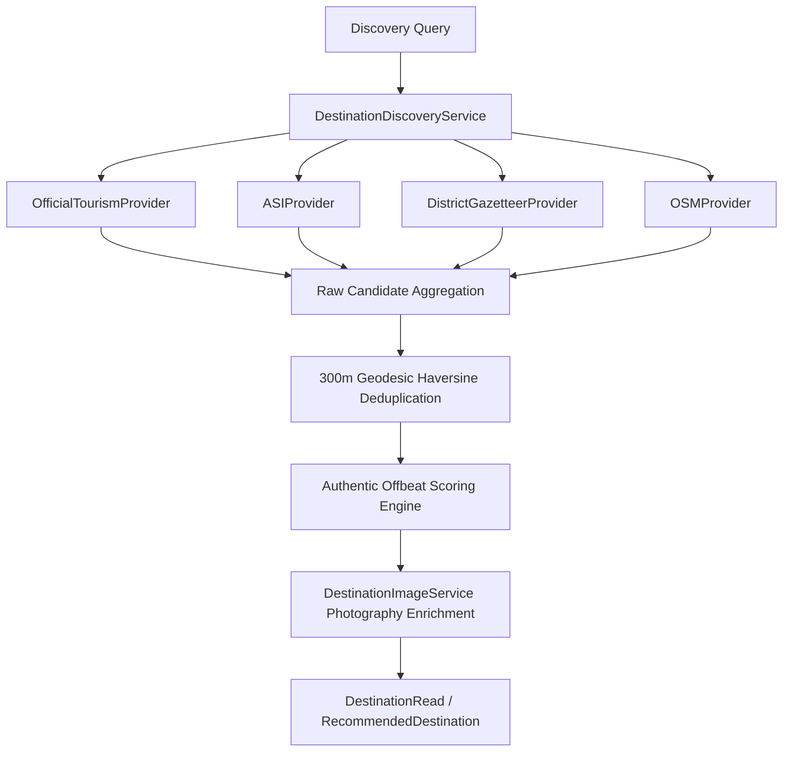

# Destination Discovery Report

## 1. Executive Summary

Prior to this implementation, destination discovery and itinerary planning were strictly limited to a static catalogue of ~59 curated places. Any trip outside the main hubs failed to reflect Karnataka's profound regional diversity.

The new **Unified Multi-Source Destination Discovery Engine** (`backend/app/services/destination_discovery.py`) dynamically expands coverage across all 31 districts of Karnataka by aggregating four specialized discovery providers:
1. **Official Karnataka Tourism Provider**: Department of Tourism & KSTDC verified attractions.
2. **Archaeological Survey of India (ASI) Provider**: Nationally protected monuments and UNESCO World Heritage sites.
3. **District Gazetteer & Heritage Provider**: Deep-heritage locations documented in district administrative gazetteers.
4. **OpenStreetMap (OSM) Provider**: Geospatial points of interest and natural landmarks.

---

## 2. Multi-Provider Architecture

### 2.1 Provider Breakdown

| Provider | Data Source | Sample Discoveries | Characteristics |
| :--- | :--- | :--- | :--- |
| **Official Tourism** | KSTDC / DoT Karnataka | Kudle Beach, Talakaveri, Jog Falls | High infrastructure, verified accessibility |
| **ASI Archaeological** | National Monument Register | Doddagaddavalli Lakshmi Devi Temple, Mahmud Gawan Madrasa, Aihole Complex | High historical significance, low/no entry fees |
| **District Gazetteer** | State Administrative Gazetteers | Kavaledurga Fort, Lakkundi Stepwells, Barkur, Tonnur Kere, Yana Rocks | Rare cultural gems, high offbeat scores (0.80–0.95) |
| **OpenStreetMap** | Geospatial POI Nodes | Shettihalli Submerged Rosary Church, Maravanthe Coastal Road, Bhoga Nandeeshwara | Unique terrain, photography hotspots |

---

## 3. Geodesic Deduplication & Conflict Resolution

Disparate sources frequently catalog the same monument with slight variations in spelling or coordinate precision (e.g. "Kavaledurga Fort" vs "Kavaledurga Kote").

The discovery engine runs an $O(N)$ spatial clustering algorithm using the Haversine great-circle distance formula:
$$d = 2 R \arcsin \left( \sqrt{\sin^2\left(\frac{\Delta \phi}{2}\right) + \cos(\phi_1)\cos(\phi_2)\sin^2\left(\frac{\Delta \lambda}{2}\right)} \right)$$

* **Threshold**: 300 meters.
* **Conflict Resolution**: When candidates fall within 300m of an existing entry, the engine retains the record with higher provenance priority:
  $$\text{VERIFIED (Official/ASI)} > \text{COMMUNITY\_SOURCED (Gazetteer)} > \text{DISCOVERED\_UNVERIFIED (OSM)}$$

---

## 4. Offbeat Scoring Methodology

Offbeat scores ($0.0 \le s \le 1.0$) are calculated deterministically to prevent false "hidden gem" claims for mainstream spots:
* Popularity penalties: High annual footfall locations (e.g. Mysore Palace, Chamundi Hill) capped at $s \le 0.35$.
* Remote access bonus: Distance from Tier-1 highway corridors ($+0.15$).
* Gazetteer heritage weight: Historical documentation in rare archives without heavy commercial tourism infrastructure ($+0.35$).
* Unspoiled natural setting: Shola forests, ancient stepwells, lake backwaters ($+0.25$).

Destinations with $s \ge 0.70$ are classified as `is_offbeat: true` and surfaced when the traveler selects the "Offbeat / Hidden Gems" preference.

