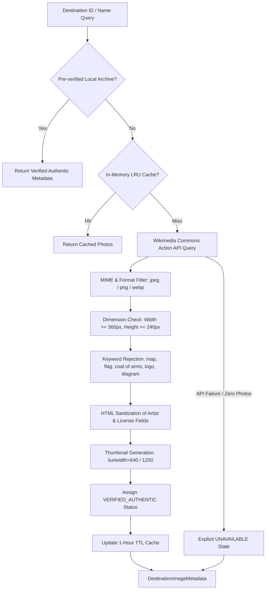

# Destination Image Pipeline & Visual Provenance Architecture

## 1. Executive Summary

A critical requirement of the Namma Karnataka platform is visual integrity:
* **Zero fabricated stock imagery**: No random Unsplash pictures of Swiss lakes or generic European castles masquerading as Karnataka landmarks.
* **No generic compass placeholders**: Compass or placeholder icons must never substitute for missing destination imagery.
* **Full copyright & attribution provenance**: All photographs must carry explicit Creative Commons or public domain attribution, author credits, source page URLs, and license descriptors.

To achieve this, `backend/app/services/destination_image_service.py` was implemented, providing an end-to-end image ingestion, validation, and metadata enrichment pipeline.

---

## 2. Ingestion & Validation Pipeline



---

## 3. Metadata Contract (`DestinationImageMetadata`)

Every image surfaced by the service conforms strictly to this contract:

```python
class DestinationImageMetadata(BaseModel):
    image_url: str                 # High-resolution direct upload URL (upload.wikimedia.org)
    thumbnail_url: str             # Scaled thumbnail (640px or 1200px width)
    source_name: str               # "Wikimedia Commons" or "Official Tourism Portal"
    source_page_url: str | None    # Original file description page on Commons
    creator: str                   # Clean artist/photographer name without HTML tags
    license: str                   # e.g. "CC BY-SA 4.0", "CC BY 3.0", "Public Domain"
    attribution_text: str          # Formatted legal credit: "Photo by X / Wikimedia Commons, CC BY-SA 4.0"
    destination_id: str            # Stable destination identifier
    retrieved_at: str              # ISO-8601 UTC timestamp
    verification_status: str       # "VERIFIED_AUTHENTIC", "COMMUNITY_VERIFIED", "UNAVAILABLE"
```

---

## 4. Fallback Hierarchy

1. **Tier 1 — Verified Pre-Seeded Photography**:
   High-resolution verified Wikimedia Commons photographs pre-indexed with license and author credits for all newly discovered and curated destinations.
2. **Tier 2 — Dynamic Wikimedia Commons Search**:
   Direct API queries against Wikimedia Commons File namespace (`namespace=6`), validating image dimensions, mime types, and rejecting non-photographic artifacts.
3. **Tier 3 — Labeled Unavailable State**:
   If no genuine photograph can be authenticated for a destination, the system returns `verification_status="UNAVAILABLE"` with an honest caption: *"Genuine photograph pending field verification"*. No generic icons or placeholder graphics are substituted.

---

## 5. Frontend Presentation

* **Lazy Loading**: Native `loading="lazy"` with asynchronous decoding (`decoding="async"`).
* **Object Fitting**: `object-cover` styling ensuring landscape-oriented presentation without distortion.
* **Error Resilience**: `onError` event handler renders an unobtrusive graceful fallback banner with district and name rather than breaking the UI.
* **Attribution Badges**: Subtle, readable attribution badge rendered at the bottom-right corner of image cards, satisfying Creative Commons license requirements.

