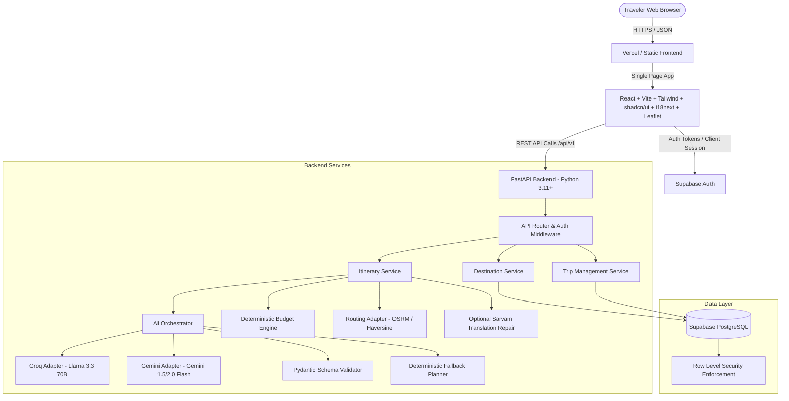

# NAMMA KARNATAKA
## Implementation Decisions and Architecture Blueprint (Phase 0 Lock)

**Product:** Namma Karnataka (ನಮ್ಮ ಕರ್ನಾಟಕ)  
**Document ID:** NK-DEC-001  
**Version:** 1.0  
**Phase:** Phase 0 — Scope, Requirements Lock & Architecture Blueprint  
**Status:** ACCEPTED BASELINE FOR PHASE 1  
**Target Environment:** Google Antigravity IDE  
**Primary Language Support:** English (`en`) and Kannada (`kn`)  
**Geographic Scope:** Karnataka, India  
**Date:** October 2026  

---

## 1. Project Overview and Executive Intent

Namma Karnataka is an AI-powered regional travel discovery and itinerary-planning application tailored specifically for the state of Karnataka, India. Its mission is to transform a traveler's duration, budget, origin, interests, and travel pace into feasible, culturally grounded, and transparent itineraries while highlighting both iconic landmarks and editorially curated lesser-known ("offbeat") destinations.

The application explicitly departs from generic chatbot interfaces. It pairs structured, source-verified destination data with deterministic calculation services (budget, route feasibility) and uses dual Large Language Model (LLM) providers (Groq and Google Gemini) as candidate itinerary generators under strict schema validation and bounded fallback policies.

---

## 2. MVP Boundary and Release Scope Classification

To ensure controlled execution, modular delivery, and high software quality, all prospective features are partitioned into four strict classifications:

| Category | Definition | Enforcement |
|---|---|---|
| `MVP_REQUIRED` | Essential for core value proposition, resilience, security, and bilingual user experience. Must be implemented and verified before initial release. | Release-blocking |
| `MVP_OPTIONAL` | Enhancements that provide value if schedule and token/budget allowances permit during Phase 4/5. | Non-blocking |
| `POST_MVP` | Planned architectural evolutions deferred until after MVP stabilization and user feedback. | Excluded from Phase 1–5 |
| `OUT_OF_SCOPE` | Explicitly excluded from product scope. | Never implemented |

### 2.1 Feature Classification Matrix

| Feature / Capability | Classification | Justification & Guardrails |
|---|---|---|
| **Bilingual Application Shell (EN/KN)** | `MVP_REQUIRED` | First-class parity for Kannada and English across navigation, forms, error states, and itinerary views. |
| **Curated Destination Discovery** | `MVP_REQUIRED` | Filterable, searchable catalog of verified Karnataka destinations with category, district, and verified metadata. |
| **Trip Preference Form** | `MVP_REQUIRED` | Responsive form capturing origin, duration (1–7 days), group size, budget, pace, interests, and transport mode. |
| **Dual AI Orchestrator (Groq & Gemini)** | `MVP_REQUIRED` | Isolated provider adapters behind a common interface; primary-then-secondary fallback within total request timeout budget. |
| **Strict Schema Output Validation** | `MVP_REQUIRED` | Pydantic validation of all AI outputs against `ItineraryResponse` schema; rejects ungrounded destination IDs. |
| **Deterministic Rule-Based Fallback** | `MVP_REQUIRED` | Generates a valid itinerary from curated destination data when both AI providers fail/timeout, provided sufficient catalog data matches. |
| **Deterministic Budget Engine** | `MVP_REQUIRED` | Authoritative Python calculation of total and per-person costs from structured line items; distinguishes verified from estimated costs. |
| **Interactive Map Visualisation** | `MVP_REQUIRED` | Leaflet map with waypoint markers, route stop sequences, and clear attribution; graceful fallback when coordinates or routing fail. |
| **Guest Planning Experience** | `MVP_REQUIRED` | Anonymous users can explore, configure, and generate full itineraries in-memory without mandatory signup. |
| **Authenticated Saved Trips** | `MVP_REQUIRED` | Supabase Auth (Email/Password or Magic Link) enabling users to save, list, view, and delete their own trips. |
| **Row Level Security (RLS)** | `MVP_REQUIRED` | Supabase RLS policies ensuring users can only read/write their own private trips and itinerary snapshots. |
| **Honest Route & Uncertainty Display** | `MVP_REQUIRED` | Clear visual badges for verified facts, estimates, and unknowns; straight-line distances never labeled as road routes. |
| **Sarvam AI Translation Repair** | `MVP_OPTIONAL` | Targeted translation repair for dynamic itinerary text fields if LLM Kannada generation exhibits grammatical flaws. |
| **PDF / Print Export of Itinerary** | `MVP_OPTIONAL` | Clean client-side print CSS / export view for travelers on the road. |
| **IndicTrans2 Self-Hosted Translation** | `POST_MVP` | Heavyweight GPU deployment; deferred until translation traffic justifies dedicated infrastructure. |
| **User Reviews and Social Feeds** | `POST_MVP` | Requires moderation pipelines, profanity filters, and spam protection; deferred to protect MVP data integrity. |
| **Multi-State / South India Extension** | `POST_MVP` | Maintain strict Karnataka focus for MVP to ensure depth of curated coverage. |
| **Collaborative Trip Planning** | `POST_MVP` | Multi-user editing of trips deferred to post-MVP. |
| **Live Booking & Payment Processing** | `OUT_OF_SCOPE` | Out of scope. Namma Karnataka is a planning assistant, not an Online Travel Agency (OTA). |
| **Real-Time Traffic Prediction** | `OUT_OF_SCOPE` | Dynamic traffic requires expensive enterprise routing APIs; static route distance/time estimates used instead. |
| **Live Hotel/Transport Availability** | `OUT_OF_SCOPE` | No live inventory integrations; static price ranges and estimates clearly flagged. |
| **Emergency & Medical Guarantees** | `OUT_OF_SCOPE` | Legal liability exclusion; app provides informational guidance only. |

---

## 3. Architecture Decisions Summary

The full architectural context is recorded in the Architecture Decision Records (`docs/ADR/`). The key consensus items are locked below:

### 3.1 Frontend Architecture Baseline
- **Framework:** React 18+ with TypeScript and Vite.
- **Styling & UI:** Tailwind CSS with shadcn/ui components (Radix primitives for accessible dialogs, selects, accordions).
- **Client State & Caching:** TanStack Query (React Query) for server-state caching, optimistic updates, and background refetching.
- **Routing:** React Router v6+ with guarded routes for `/saved-trips`.
- **Localization:** `i18next` and `react-i18next` with strictly separated static JSON catalogs (`src/locales/en/common.json`, `src/locales/kn/common.json`). Language toggle persists in `localStorage` and propagates via `Accept-Language` header to backend.
- **Mapping:** Leaflet with `react-leaflet` using OpenStreetMap / CartoDB tiles with mandatory attribution and accessible text-list alternative.

### 3.2 Backend Architecture Baseline
- **Framework:** Python 3.11+ with FastAPI.
- **Validation & Serialization:** Pydantic v2 schemas across all layers (API schemas, domain entities, provider payloads, and persistence models).
- **HTTP Client:** `httpx.AsyncClient` with connection pooling, explicit per-provider timeouts, and backoff retries.
- **API Versioning:** All routes strictly prefixed with `/api/v1/`.
- **Modularity:** Layered domain boundaries:
  - `app/api/v1/`: HTTP route handlers, request validation, response mapping.
  - `app/services/`: Core business logic (itinerary orchestration, budget calculation, destination search).
  - `app/adapters/`: External provider integrations (Groq, Gemini, OSRM, Sarvam).
  - `app/repositories/`: Database query layer wrapping Supabase PostgreSQL.
  - `app/schemas/`: Pydantic models and Enums.
  - `app/core/`: Configuration, logging, exception handlers, security.

### 3.3 Database and Persistence Baseline
- **Provider:** Supabase PostgreSQL with PostGIS extension (for spatial queries).
- **Migrations:** Sequential SQL migrations version-controlled in `supabase/migrations/`.
- **Public Data vs. Private Data:**
  - Public: `districts`, `destinations`, `destination_translations`, `destination_tags`, `destination_sources`, `destination_costs`. Read-only to anonymous users.
  - Private: `trips`, `itinerary_snapshots`, `user_preferences`, `feedback`. Strictly protected by PostgreSQL Row Level Security (`user_id = auth.uid()`).
- **Snapshot Immutability:** Generated itineraries are persisted as immutable JSON snapshots in `itinerary_snapshots` with schema versioning (`schema_version = "1.0"`). Subsequent updates to the destination catalog do not corrupt previously saved itineraries.

---

## 4. Authentication and Guest-Planning Policy

* **Decision Status:** `ACCEPTED`
* **Policy:** "Plan first, sign in later."
* **Rules:**
  1. Any anonymous user can browse destinations, search, filter, and submit trip preferences to `/api/v1/itineraries/generate`.
  2. The generated itinerary is returned directly in the HTTP response and held in frontend application state / React Query cache.
  3. No anonymous trip record is forced into the PostgreSQL database.
  4. When an unauthenticated user clicks "Save Trip", a non-intrusive modal or banner prompts them to Sign Up or Log In via Supabase Auth.
  5. Upon successful authentication, the frontend immediately posts the current itinerary and preferences to `POST /api/v1/trips` with the verified Bearer token, persisting the trip without data loss.
  6. Backend endpoint `POST /api/v1/trips` extracts `user_id` strictly from the cryptographically verified JWT (`auth.uid()`). It rejects any client-supplied `user_id` in request payloads.

---

## 5. AI Provider Strategy and Orchestration

* **Decision Status:** `ACCEPTED`
* **Primary Provider:** Groq (`llama-3.3-70b-versatile` or current production equivalent) for high-speed, cost-effective inference.
* **Secondary Provider:** Google Gemini (`gemini-1.5-flash` or `gemini-2.0-flash`) for resilient failover.
* **Execution Mode:** `primary_then_fallback` (configurable via `AI_EXECUTION_MODE`).
  - To minimize token waste and maintain predictable API budgets, the orchestrator does not invoke both providers in parallel by default.
  - Step 1: Query Primary Provider (Groq) with candidate destination JSON, user constraints, and JSON schema instructions (timeout: 12 seconds).
  - Step 2: Validate output using Pydantic `ItineraryResponse`. Verify all returned destination IDs exist in the curated catalog.
  - Step 3: If Groq succeeds and output validates, proceed to budget recalculation and return.
  - Step 4: If Groq fails (network error, rate limit 429, timeout, or malformed JSON), immediately log the failure classification and call Secondary Provider (Gemini) with identical inputs (timeout: 15 seconds).
  - Step 5: If Gemini succeeds and validates, set `generation_mode = "gemini"`, `fallback_used = true`, and return.
  - Step 6: If both providers fail, trigger the Deterministic Fallback Planner.
* **Total Time Budget:** Max 28 seconds for AI stage before falling back to rule-based generation.

---

## 6. Deterministic Fallback Policy

* **Decision Status:** `ACCEPTED`
* **Trigger Conditions:**
  1. Groq and Gemini both encounter fatal errors, timeouts, or rate limits.
  2. Both providers return malformed JSON that fails schema validation after bounded repair.
  3. Both providers hallucinate destination IDs outside the curated candidate set.
  4. System is run in offline/test mode (`AI_ENABLE_LIVE_PROVIDERS=false`).
* **Eligibility Rules:**
  - The fallback engine queries the local destination repository for active, verified destinations matching:
    - User's selected origin / region proximity.
    - User's selected interests (category matching).
    - Pace constraints (e.g., 2 stops/day for relaxed, 3 for balanced, 4 for packed).
  - Minimum Data Threshold: For a trip of $D$ days, there must be at least $D \times 1$ eligible destinations available.
* **Behavior:**
  - If threshold is met: Generate a geographically clustered, sequential day-by-day itinerary. Set `generation_mode = "deterministic_fallback"`, `fallback_used = true`. Display a clear, reassuring bilingual banner: *"Generated using curated destination data due to temporary AI service unavailability."*
  - If threshold is not met: **Do not invent destinations.** Return a clear, recoverable error code `NO_ELIGIBLE_DESTINATIONS` or `AI_PROVIDERS_UNAVAILABLE` with localized guidance asking the user to expand their interests or select a nearby major hub. **Retain all user inputs in the form.**

---

## 7. Destination Data Quality and Provenance Policy

* **Decision Status:** `ACCEPTED`
* **Rules:**
  1. **Ground Truth Catalog:** AI models are never allowed to create destination records in the database. Recommendations must reference pre-existing, verified IDs (`dst_<uuid_or_stable_slug>`).
  2. **Mandatory Fields for Publication:**
     - Unique stable ID and slug.
     - English name (`name_en`).
     - District code (FK to `districts`).
     - Category (controlled enum).
     - Geographic coordinates (`latitude`, `longitude`) in WGS84, or explicit `null` with warning.
     - Verification status (`human_reviewed`, `source_checked`, `needs_review`, `stale`).
     - Access status (`open_reported`, `restricted`, `seasonal`, `closed_reported`, `unknown`).
     - At least one source record in `destination_sources` with `source_name`, `checked_at`, and `license_notes`.
  3. **Zero vs. Unknown Handling:**
     - Missing entry fees or activity costs must NEVER be set to `0`. A cost of `0` means verified free entry. Unknown costs are stored as `null` with `status = "unknown"`.
  4. **Offbeat Classification Guardrail:**
     - The label `is_offbeat = true` is strictly an editorial discovery classification.
     - The UI must always accompany offbeat tags with a standard safety disclaimer: *"Offbeat destinations may have limited facilities, seasonal road conditions, or patchy mobile connectivity. Plan travel during daylight."*
  5. **Restricted Destinations:**
     - Destinations marked `restricted` or `closed_reported` are strictly excluded from recommendation queries.

---

## 8. Budget and Route Uncertainty Policy

* **Decision Status:** `ACCEPTED`
* **Budget Engine Rules:**
  - Backend code (`app/services/budget.py`) has sole authority over final totals.
  - The LLM may recommend activities, but backend calculates line items and sums them deterministically.
  - Cost categories: Transport (inter-city), Local Commute, Stay, Food, Entry/Activities, Contingency.
  - Each line item displays its status: `verified`, `estimated`, `user_provided`, or `unknown`.
  - The UI presents budget ranges (e.g., ₹12,000 – ₹15,000) and displays both group total and per-person breakdown.
  - If costs for a stop are unknown, the UI displays a badge: *"Entry/Activity cost: Not available — check locally."*
* **Route and Distance Rules:**
  - Route distances and travel times are provided by the configured routing adapter (e.g., OSRM).
  - If routing adapter succeeds: Display road distance and duration labeled *"Estimated road travel"*.
  - If routing adapter fails or is unconfigured: Calculate Haversine straight-line distance, append a 30% road-factor buffer, and explicitly label it: *"Straight-line estimate (~X km). Road time unavailable."*
  - Never draw a straight map line and represent it as an actual road trajectory.

---

## 9. Language and Localization Policy

* **Decision Status:** `ACCEPTED`
* **Core Principles:**
  1. Equal first-class status for English (`en`) and Kannada (`kn`).
  2. UI elements (navigation, buttons, form labels, errors, tooltips, empty states) use static translation keys managed via `react-i18next`.
  3. Destination editorial content (names, descriptions, access notes) is stored in the database in `destination_translations` for both languages.
  4. Dynamic AI-generated itinerary text (day overviews, custom advice):
     - Prompt instructs the LLM to output all human-readable text directly in the requested language (`kn` or `en`).
     - IDs, dates, numbers, currency codes, and enum literals remain unlocalized in machine-readable JSON keys.
  5. If Kannada generation contains minor English loanwords or ungrammatical text, the system optionally applies Sarvam AI repair if enabled.
  6. Failure of an AI provider, translation service, or network call must NEVER reset the UI language to English. The selected language is persistent and inviolable.

---

## 10. Security Baseline

* **Decision Status:** `ACCEPTED`
* **Key Controls:**
  1. **Zero Client Secrets:** `GROQ_API_KEY`, `GEMINI_API_KEY`, `SARVAM_API_KEY`, and `SUPABASE_SERVICE_ROLE_KEY` are strictly server-side environment variables. Never prefix with `VITE_`.
  2. **Supabase Client Credentials:** Frontend only receives `VITE_SUPABASE_URL` and `VITE_SUPABASE_ANON_KEY`.
  3. **Row-Level Security (RLS):** Enabled and enforced on all PostgreSQL tables containing user data.
  4. **Strict Token Verification:** Backend validates Supabase JWT on all private endpoints using Supabase JWT secret / JWKS.
  5. **Input Sanitization & Injection Defense:**
     - Form text inputs (e.g., custom interests, origin) are stripped of control characters, length-limited (max 100 chars), and treated as data variables in LLM prompt templates, never concatenated as executable system instructions.
  6. **Error Sanitization:** API error responses return structured JSON with safe error codes and human-readable messages. Internal stack traces, raw SQL, and provider response headers are logged internally with correlation IDs but never returned to clients.
  7. **CORS:** Restricted to allowed frontend origins in production.

---

## 11. Deployment and Operational Strategy

* **Decision Status:** `PROPOSED` (To be validated in Phase 4/5)
* **Frontend Hosting:** Vercel / Netlify / Cloudflare Pages (Static SPA build with fallback routing to `index.html`).
* **Backend Hosting:** Render / Railway / Google Cloud Run (Containerized FastAPI service with health check at `/api/v1/health`).
* **Database:** Supabase Managed PostgreSQL with automatic backups and point-in-time recovery.
* **CI/CD:** GitHub Actions running:
  - Frontend: `npm run lint`, `npm run typecheck`, `npm run test`, `npm run build`.
  - Backend: `ruff check`, `mypy`, `pytest` with 100% mocked external AI/map providers.

---

## 12. Unresolved Decisions and Revisit Conditions

The following items are documented as proposed defaults and do not block Phase 1, but must be confirmed before production deployment:

| Decision ID | Item | Proposed Default | Revisit Condition | Confirmation Owner |
|---|---|---|---|---|
| `DEC-UNRES-01` | Routing Provider for Production | Free OSRM demo server for dev/staging; self-hosted OSRM or Mapbox/OpenRouteService for prod. | When staging routing volume exceeds demo server rate limits. | Tech Lead |
| `DEC-UNRES-02` | Map Tile Provider for Production | OpenStreetMap standard tiles for dev; CartoDB Positron / MapLibre for production. | Review tile usage terms before public release. | Tech Lead |
| `DEC-UNRES-03` | Destination Image Licensing | Use Wikimedia Commons / Karnataka Tourism CC-BY-SA images with explicit attribution in `destination_sources`. | Legal review prior to marketing launch. | Product Owner |
| `DEC-UNRES-04` | Max Trip Duration Limit for MVP | Cap at 7 consecutive days to control LLM context size and combinatorial route complexity. | User requests for extended tours post-MVP. | Product Owner |
| `DEC-UNRES-05` | Editorial Reviewer for Kannada Content | Native Kannada speaker reviews seed catalog translations before production deploy. | Before seeding production DB. | Content Lead |

---

## 13. Architecture Decision Record 005 (ADR-005): Phase 3 AI Provider Orchestration, Catalog Grounding, and Fallback Engine

* **Decision Status:** `ACCEPTED`
* **Date:** October 2026
* **Context:**
  Phase 3 requires reliable, hallucination-free AI generation for Karnataka travel recommendations. LLMs must not fabricate destinations, fees, coordinates, or travel durations. System availability must not depend on third-party uptime or live API keys during tests and offline usage.
* **Decisions:**
  1. **Direct HTTP Transport via httpx:**
     Groq and Google Gemini Generative Language APIs are called directly using `httpx.Client` rather than vendor-specific SDK wrappers. This eliminates heavy external C/binary dependencies, prevents import-time failures on varied Python versions, and provides uniform timeout and header control (`Bearer` for Groq, `x-goog-api-key` for Gemini).
  2. **Shared Protocol & Decoupled Architecture:**
     All AI providers implement the `AIProvider` protocol (`provider_name`, `is_configured`, `generate_plan`). The `AIOrchestrator` service interacts exclusively with the protocol, never vendor clients. Route handlers interact exclusively with `AIOrchestrator`.
  3. **Global Deadline & Dynamic Time Allocation:**
     A configurable global deadline (28 seconds default) governs the entire recommendation lifecycle. The orchestrator computes `remaining_deadline = global_deadline - elapsed` prior to every provider invocation, bounding each provider call to `min(remaining_deadline, provider_timeout)`. If remaining time drops below 2.0s, the orchestrator immediately branches to offline fallback.
  4. **Strict Schema Validation & Catalog Grounding:**
     Raw AI responses are defensively stripped of markdown fences and parsed into `RawAIPlanResponse` with Pydantic v2. Every referenced `destination_id` (slug or UUID) is strictly checked against the curated candidate pool retrieved from `DestinationRepository`. Unrecognized references raise `AI_DESTINATION_NOT_GROUNDED`. Accepted references have their metadata (coordinates, fee ranges, translations, access status) authoritatively hydrated from the repository, ignoring any model-fabricated fields. Unknown fees remain `NULL` (never converted to ₹0).
  5. **Deterministic Offline Fallback Engine:**
     When remote providers fail, time out, or are disabled, `DeterministicFallbackEngine` produces a stable, reproducible itinerary from verified seed data. Candidates are stably sorted by `(offbeat_priority, category, district_code, slug)` and distributed across requested days based on pace. The response is explicitly tagged with `generation_mode: "fallback"` and `provider_used: "deterministic_fallback"`.
  6. **Versioned Route Boundary:**
     `POST /api/v1/planning/recommendations` provides the public interface. It is protected by the `AI_PLANNING_ENABLED` feature flag (returning HTTP 403 `AI_PLANNING_DISABLED` when disabled), handles error normalization, injects `X-Request-ID`, and guarantees full bilingual parity in Kannada and English.

