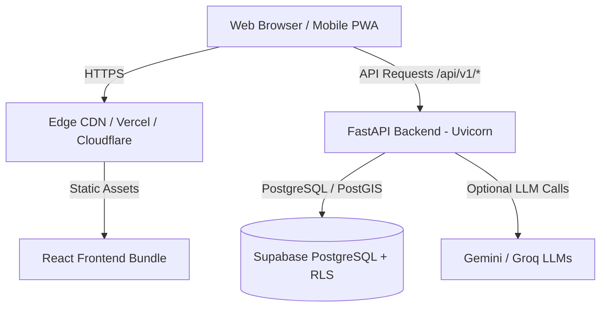

# Phase 10 — Production Deployment Readiness and Configuration

## 1. Overview and Target Topology

**Project:** Namma Karnataka (ನಮ್ಮ ಕರ್ನಾಟಕ)  
**Release Target:** Production / Staging  
**Architecture:** Decoupled Jamstack Frontend + High-Performance Asynchronous Python Backend + Managed Cloud PostgreSQL (Supabase)



---

## 2. Frontend Deployment Configuration

### 2.1 Build Output
- **Build Artifact Location:** `frontend/dist/`
- **Output Files:**
  - `dist/index.html` (SPA entrypoint)
  - `dist/assets/index-*.js` (Application bundle with vendor code, 471 kB / 141 kB gzip)
  - `dist/assets/index-*.css` (Global stylesheet, 49 kB / 13 kB gzip)
  - `dist/sw.js` (PWA Service Worker for offline asset caching)
  - `dist/manifest.webmanifest` (PWA installability metadata)
  - `dist/images/` & `dist/locales/` (Static media & localization catalogs)

### 2.2 SPA Routing & Caching Rules
For NGINX, Cloudflare Pages, Vercel, or Netlify:
- **Rewrite Rule:** Direct all non-file route requests to `/index.html` (`try_files $uri $uri/ /index.html;`).
- **Asset Caching Headers:**
  - `/assets/*`: `Cache-Control: public, max-age=31536000, immutable`
  - `/sw.js`: `Cache-Control: no-cache, no-store, must-revalidate`
  - `/index.html`: `Cache-Control: no-cache, no-store, must-revalidate`

---

## 3. Backend Deployment Configuration

### 3.1 Production Startup Command
```bash
uvicorn app.main:app --host 0.0.0.0 --port 8000 --workers 4 --proxy-headers --forwarded-allow-ips="*"
```

### 3.2 Health Check & Readiness Endpoints
- **Liveness Probe:** `GET /health` → Returns HTTP 200 `{"status": "healthy", "service": "namma-karnataka-api"}`.
- **Readiness Probe:** `GET /ready` → Returns HTTP 200 with downstream checks (`database`, `catalogue`).

### 3.3 Production CORS Settings
Ensure `CORS_ORIGINS` in production environment includes the production domain:
```ini
CORS_ORIGINS=["https://nammakarnataka.travel", "https://app.nammakarnataka.travel"]
```

---

## 4. Supabase Database & Migration State

### 4.1 Migration Order
1. `supabase/migrations/20261023000001_enable_postgis.sql` (Enables PostGIS extension)
2. `supabase/migrations/20261023000002_create_districts_and_destinations.sql` (Creates schemas, tables, and spatial indices)
3. `supabase/migrations/20261023000003_destinations_rls_policies.sql` (Enforces public read and service-role write)
4. `supabase/migrations/20261023000004_create_trips_and_snapshots.sql` (Enforces tenant isolation and trip schemas)

### 4.2 Seed Validation Status
- 61 Destinations across 31 Districts verified via `python data/validation/validate_seed.py` (Passed 100%).

---

## 5. Environment Variables Audit

| Variable | Scope | Description | Safe Example |
|----------|-------|-------------|--------------|
| `ENVIRONMENT` | Backend | Environment flag (`production` / `staging`) | `production` |
| `DEBUG` | Backend | Debug mode (MUST be false in prod) | `false` |
| `SUPABASE_URL` | Backend | Managed Supabase API endpoint | `https://xyzcompany.supabase.co` |
| `SUPABASE_SERVICE_ROLE_KEY` | Backend | Secret backend service key (Never commit) | `(Managed Secret)` |
| `GEMINI_API_KEY` | Backend | Optional AI multimodal key | `(Managed Secret)` |
| `VITE_API_BASE_URL` | Frontend | Backend API base URL | `https://api.nammakarnataka.travel/api/v1` |
| `VITE_SUPABASE_URL` | Frontend | Supabase project URL | `https://xyzcompany.supabase.co` |
| `VITE_SUPABASE_ANON_KEY` | Frontend | Supabase public anon key | `(Public Anon Key)` |

---

## 6. Deployment Packaging & Exclusion Guidelines

When packaging a release archive:
- **Include:** `backend/app/`, `backend/pyproject.toml`, `backend/.env.example`, `frontend/dist/`, `data/`, `supabase/migrations/`.
- **Strictly Exclude:**
  - All `.env` files containing live credentials
  - `node_modules/`
  - Python virtual environments (`venv/`, `.venv/`)
  - Test caches (`.pytest_cache/`, `.ruff_cache/`)
  - Local database files or logs
