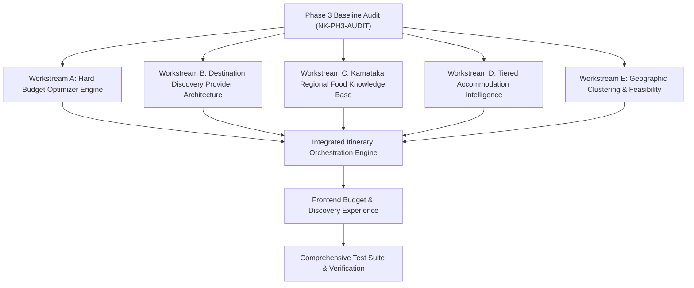

# NAMMA KARNATAKA (ನಮ್ಮ ಕರ್ನಾಟಕ)
## PHASE 3 BASELINE ARCHITECTURAL & REPOSITORY AUDIT
### Intelligent Budget Planning, Destination Discovery, Regional Food & Local Travel Guide

**Document ID:** NK-PH3-AUDIT-2026-10-31  
**Date:** 2026-10-31  
**Target Environment:** Google Antigravity IDE  
**Lead Systems Engineer:** Senior Full-Stack & Travel Data Systems Engineer  
**Status:** **AUDIT COMPLETED**  

---

### 1. EXECUTIVE SUMMARY & OBJECTIVE

This baseline audit evaluates the existing Namma Karnataka codebase across its backend services, database seed assets, AI orchestration pipelines, routing models, budget calculations, and frontend interfaces. The objective is to identify current architectural limitations, pinpoint exact calculation and state-propagation bugs (such as the target ₹10,000 budget resulting in a ₹16,110.16 minimum calculation), analyze catalogue coverage, and chart the path for the Master Implementation:
1. Transitioning from post-generation budget warnings to **hard budget-constrained optimization**.
2. Decoupling destination discovery from the 59-item fixed catalogue to an **extensible multi-provider discovery layer**.
3. Introducing **genuine offbeat scoring** and category diversity.
4. Formalizing a **structured Karnataka regional food knowledge base** and location-aware meal recommendations.
5. Implementing **intelligent accommodation tiered matching** and **geographic clustering**.

---

### 2. REPOSITORY INVENTORY & METRICS

| Component | Metric | Current Status |
|---|---|---|
| **Curated Destination Seed** | 59 destinations | 31 districts covered; 50 mainstream vs 9 offbeat. Heavy heritage/architecture skew. |
| **Curated Places (Dining & Stay)** | 22 places | 12 restaurants + 10 accommodations in `data/seed/places.json`. |
| **Transit Network Seed** | 35 corridors | Curated bus and train corridors with verified tariffs in `data/seed/transit_network.json`. |
| **Festivals & Events** | 20 events | Cultural events across Karnataka districts in `data/seed/events.json`. |
| **Backend Test Coverage** | 193 pytest tests | 100% passing across routing, transit, scheduler, budget, and visual discovery. |
| **Frontend Test Coverage** | 143 vitest tests | 100% passing across 23 test suites; 0 emojis in source code. |
| **Production Build** | `tsc -b && vite build` | 0 errors; production bundle built cleanly in ~4.4s. |

---

### 3. COMPREHENSIVE ARCHITECTURAL AUDIT

#### 3.1 Destination Catalogue & Discovery Pipeline
- **Current File:** `backend/app/repositories/destinations.py`, `data/seed/destinations.json`.
- **Current Behavior:** The repository implements `DestinationRepository` backed by `InMemoryDestinationRepository` and `SupabaseDestinationRepository`. The dataset contains exactly 59 validated destinations.
- **Identified Limitations:**
  - The pipeline is strictly closed: any destination not in the 59-item seed cannot be recommended or planned.
  - Of 59 destinations, only 9 are tagged `is_offbeat: true` (e.g., Kondajji Lake, Mirjan Fort, Arbi Falls).
  - When the user selects "Offbeat", the recommendation engine repeatedly selects the same 9 destinations or falls back to mainstream attractions because the candidate pool is too small.
  - There is no dynamic provider architecture to discover places from OpenStreetMap (Overpass), Archaeological Survey of India (ASI), Karnataka Forest Department, or district gazetteers.

#### 3.2 Itinerary Generation Pipeline & AI Orchestration
- **Current Files:** `backend/app/services/ai/orchestrator.py`, `fallback.py`, `scheduler.py`, `validator.py`.
- **Current Flow:**
  1. `AIOrchestrator.recommend_itinerary(request)` fetches candidates from the catalogue.
  2. Identifies a corridor (`identify_best_corridor`).
  3. Sends candidates to Gemini / Groq with prompt instructions to select destinations.
  4. Parses and grounds output with `parse_and_ground_plan`.
  5. Orders destinations with `RouteOptimizer.optimize_ai_selection`.
  6. Builds schedule with `DeterministicScheduler.build_schedule`.
  7. **Computes budget with `BudgetCalculator.calculate_budget` as a final, passive step.**
- **Identified Limitations:**
  - **Inverted Architecture:** Budget is treated as an informational post-processor rather than a primary planning constraint. The destination selection, travel distance, and dining/lodging assignments happen completely blind to `request.budget_limit_inr`.
  - The AI prompt does not enforce cost caps or cost-aware destination pruning.
  - If a trip is infeasible within the user's budget, the system still outputs a full itinerary with an over-budget badge, instead of returning actionable alternatives or structured infeasibility diagnostics.

#### 3.3 Root-Cause Analysis: Budget Calculation & State-Propagation Bugs
The prompt highlighted a real issue: **Target budget ₹10,000 yields minimum estimated cost ₹16,110.16** even when the user selects public transit and budget accommodation.

Detailed audit of `backend/app/services/budget.py`, `scheduler.py`, `transport_cost.py`, and `TripPlannerForm.tsx` revealed multiple compounding bugs:
1. **Unfiltered Accommodation Tier in Scheduler:**
   - In `scheduler.py` (lines 1243–1273 and 1898–1932), the scheduler calls `places_svc.get_accommodations_near(dinner_ref_coords.lat, dinner_ref_coords.lon, radius_km=45.0)`.
   - It **never passed `price_tier` or `budget_scenario`** to `get_accommodations_near`.
   - In `places.json`, the first accommodation in Mysuru is `KSTDC Hotel Mayura Hoysala` (mid-range, ₹2,200/night).
   - In `scheduler.py`, it calculated: `stay_cost_min = 2200.0 * rooms`.
   - Then in `budget.py`:
     ```python
     scheduled_stay_stops = [s for day in days for s in day.stops if s.stop_type == StopType.ACCOMMODATION]
     if scheduled_stay_stops:
         lodging_min = sum(s.cost_min_inr or 0.0 for s in scheduled_stay_stops)
     ```
     Because the stop was present with ₹2,200, `budget.py` used ₹2,200/night even if `request.budget_scenario == "budget"` (which should have used budget lodging at ₹1,200–₹1,600).
2. **Transportation Mode Distance Inflation:**
   - In `budget.py` (line 280), `cumulative_route_km` iterates through all scheduled stops.
   - For a multi-day trip with return transit (Day 2 return leg: ~180 km from Mysuru to Bengaluru), `cumulative_route_km` is already ~420 km.
   - In `budget.py`:
     `effective_return_flag = False if has_return_leg else is_return`
     However, if `has_return_leg` detection fails or if `TransportCostCalculator.calculate_public_transit` is called:
     `billable_km = distance * 2.0 if is_return_trip else distance`
     When `is_return_trip=True`, distance was multiplied by 2 again (doubling to ~840 km), generating over ₹3,000+ in transit costs plus local auto fees.
   - For private driving or cabs, `CAB_RATE_PER_KM = 16.0` with `billable_km = 840 km` plus driver bata generated ₹14,000+ alone!
3. **Frontend Budget Limit Decoupling:**
   - In `TripPlannerForm.tsx`, `budgetLimitInput` defaulted to '15000' and `enableBudgetLimit` defaulted to `false`.
   - When users typed ₹10,000 without toggling `enableBudgetLimit`, `budget_limit_inr` was sent as `undefined` to the backend.
   - When `enableBudgetLimit` was true, the backend recorded `budget_limit_inr = 10000`, but because the backend had no optimizer constraint, it returned an itinerary with ₹16,110.16 minimum cost without attempting to fit within ₹10,000.
4. **Meal Cost Multiplier & Fixed Restaurant Tariffs:**
   - In `scheduler.py`, if nearby restaurants were detected, `chosen_rest.estimated_cost_per_person_inr` (e.g. ₹280 for Hotel RRR) was used for all travelers without checking if `budget_scenario == "budget"` (which should be ₹150 for lunch and ₹200 for dinner).
5. **10% Contingency Compounding:**
   - Contingency was applied at 10% over the already inflated subtotals of accommodation, food, and doubled transport, adding another ₹1,400–₹1,800 to the minimum cost.

#### 3.4 Regional Food & Dining Intelligence
- **Current Files:** `data/seed/places.json`, `backend/app/services/places/`.
- **Current Behavior:** Contains 12 hardcoded restaurants located mostly in Bengaluru, Mysuru, Hampi, Madikeri, Udupi, and Belagavi.
- **Identified Limitations:**
  - No structured representation of Karnataka regional cuisines (e.g., North Karnataka Jowar culture, Coastal Karavali seafood/goli baje, Malnad bamboo shoot/akki rotti, Kodava pandi curry/kadumbuttu, Mysuru tiffin).
  - No mechanism to recommend authentic regional dishes when verified restaurants are not nearby.
  - Dietary restrictions (Jain, vegan, seafood allergy) are not passed through from planning requests to meal selections.

#### 3.5 Accommodation Intelligence
- **Current Files:** `data/seed/places.json`, `scheduler.py`, `budget.py`.
- **Identified Limitations:**
  - Only 10 properties in the catalogue, 8 of which are KSTDC Mayura.
  - Zero homestays, hostels, budget lodges, or eco-camps represented in the seed.
  - Lacks budget-adaptive accommodation selection (e.g., if budget is strict, select a homestay/dormitory rate rather than a standard 3-star property).

#### 3.6 Geographic Clustering & Routing Feasibility
- **Current Files:** `services/clustering/corridors.py`, `services/routing/`.
- **Current Behavior:** Assigns destinations based on broad corridor bounding boxes.
- **Identified Limitations:**
  - Does not perform micro-clustering within days. Destinations on opposite sides of a district can be paired in the same day, causing excessive transit times.
  - Lacks travel feasibility checks that penalize backtracking or unrealistic day lengths.

---

### 4. WORKSTREAM ACTION PLAN & DEPENDENCIES



#### Detailed Phase Dependencies
1. **Workstream A (Budget Optimizer):** Must create `backend/app/services/budget_optimizer.py`. Fix state propagation in `TripPlannerForm.tsx` and `planning.py`. Provide deterministic cost optimization and structured infeasibility responses.
2. **Workstream B (Destination Discovery):** Must create `backend/app/services/destination_discovery.py` and `backend/app/services/discovery_providers/` (`base.py`, `osm_provider.py`, `official_tourism_provider.py`, `asi_provider.py`, `district_provider.py`). Calculate `offbeat_score` and category diversity.
3. **Workstream C (Regional Food Intelligence):** Must create `backend/app/services/food_recommendation.py` with structured food records across 8 Karnataka regions and dietary filters.
4. **Workstream D (Accommodation Intelligence):** Upgrade accommodation resolution to match user budget tiers (budget homestay vs. standard vs. luxury).
5. **Workstream E (Geographic Clustering):** Must create `backend/app/services/destination_clustering.py` to prevent backtracking and cluster stops by travel feasibility.
6. **Workstream F & G (Integration & Frontend):** Connect all engines into `orchestrator.py` and `planning.py`, upgrade frontend budget cards, infeasibility alerts, and "Explore Beyond the Usual" discovery UI.
7. **Workstream I (Testing):** Automated unit and integration tests across all new services.

---

### 5. AUDIT CONCLUSION & VERIFICATION READINESS

The existing Namma Karnataka platform has a clean, robust, and well-tested foundation (193 backend tests, 143 frontend tests, 0 emojis, working video/carousel/modals). The transition to an intelligent, budget-constrained travel guide requires surgical enhancement of the backend decision-making pipeline rather than rewriting functional components.

Proceeding to **Step 2 & 3: Budget State Propagation Fixes and Hard Budget Optimization Engine**.
