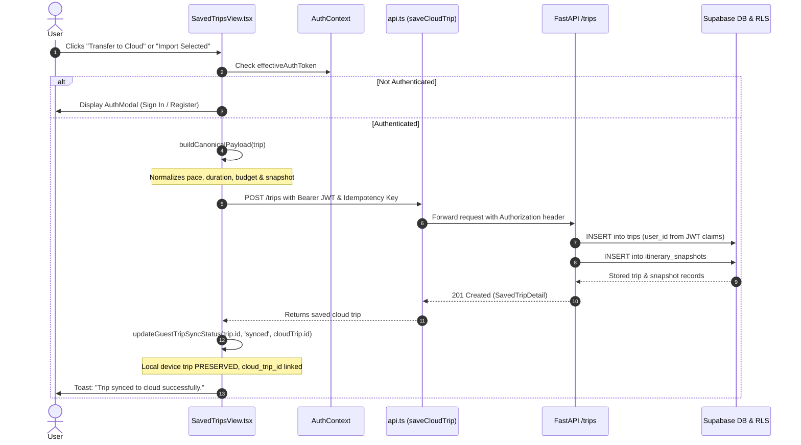

# Completion Report: Saved Trips UI Redesign & Cloud Transfer Fix

**Platform:** Namma Karnataka (ನಮ್ಮ ಕರ್ನಾಟಕ)  
**Date:** November 3, 2026  
**Status:** Completed & Fully Verified  
**Related Documents:** [Root Cause Analysis](file:///c:/Namma%20Karnataka/docs/SAVED_TRIPS_TRANSFER_ROOT_CAUSE.md)

---

## 1. Executive Summary

This deliverable accomplishes a complete modernization and stabilization of the **Saved Trips** module in Namma Karnataka. Prior to this update, users experienced a cluttered, oversized blue account notice, inconsistent card hierarchies, missing image previews, and critical failures when attempting to transfer local device itineraries to their cloud account (resulting in Pydantic schema validation crashes and silent import failures).

The module has been refactored to deliver a clean, modern travel dashboard with seamless Device → Cloud itinerary synchronization adhering strictly to the principle of **Copy to Cloud + Preserve Device Copy**.

---

## 2. Root Cause Summary & Backend Repairs

A comprehensive root-cause analysis was completed and documented in [`docs/SAVED_TRIPS_TRANSFER_ROOT_CAUSE.md`](file:///c:/Namma%20Karnataka/docs/SAVED_TRIPS_TRANSFER_ROOT_CAUSE.md). The critical defects identified and repaired include:

### 2.1 Backend Pydantic Schema Crash in `get_trip`
* **Defect:** `SupabaseTripRepository.get_trip` passed raw database rows from `itinerary_snapshots` directly into `SavedTripDetail(snapshot=...)`. Pydantic's strict model (`extra="forbid"`) threw **7 validation errors** on database columns (`id`, `trip_id`, `user_id`, `schema_version`, `created_at`) and missing required fields (`language`, `duration_days`), triggering HTTP 500 errors whenever cloud trip details were fetched.
* **Fix (`backend/app/repositories/trips.py`):**
  Reconstructed `snapshot_obj` explicitly from database snapshot data, ensuring exact conformance with `PlanningRecommendationResponse` without leaking internal columns.
  Verified live with authenticated Supabase queries on test trips.

### 2.2 Dynamic `total_stops` and Preference Persistence
* **Defect:** `trips` database table did not maintain a dedicated column for stop counts, causing `list_user_trips` to hardcode `total_stops = 0`.
* **Fix (`backend/app/repositories/trips.py`):**
  Updated `create_trip` to persist `total_stops` and `language` in `preferences`. Updated `list_user_trips` to extract `total_stops` dynamically with fallback to snapshot item counts.

### 2.3 Authentication Token Desynchronization in Frontend
* **Defect:** `SavedTripsView` previously evaluated `if (!authToken)` across multiple action handlers instead of utilizing `effectiveAuthToken` (derived from both props and `AuthContext`). Users signed in via Supabase Auth were blocked from transferring trips.
* **Fix (`frontend/src/features/saved-trips/SavedTripsView.tsx`):**
  Standardized all transfer, tab switching, and retrieval operations to rely on `effectiveAuthToken`.

---

## 3. UI Redesign Implementation

### 3.1 Page Header
* **Clean Typography Hierarchy:** Styled with responsive typography (`var(--font-serif)` for the English title alongside `var(--font-kannada)` for authentic bilingual representation).
* **Clear Subtitle:** "Manage, revisit, and synchronize your Karnataka journeys."
* **Elimination of Clutter:** Replaced bulky hero containers with compact, elegant heading layouts.

### 3.2 Compact Account & Sync Status Bar
* **Replaced Oversized Blue Banner:** Replaced the previous 200px+ blue panel with a sleek 48px status bar (`.saved-trips-status-bar`).
* **Visual States:**
  * **Cloud Connected:** Green badge with check icon, user email/identity, and an inline `Sign Out` button.
  * **Guest / Device Only:** Amber/slate badge ("Guest Mode (Device Storage)"), prompt to connect, and an inline `Sign In / Connect` button.
* **Real-time Status Indicator:** Displays pending sync indicators when unlinked device trips are present.

### 3.3 Storage Tabs
* **Modern Segmented Design:** Replaced standard button rows with an accessible segmented control (`.saved-trips-segmented-tabs`).
* **Dynamic Count Badges:**
  * `Device Trips` with pill badge showing current device count (e.g., `2`).
  * `My Cloud Trips` with pill badge showing cloud count (e.g., `5`).
* **Seamless Switching:** Automatically refreshes cloud trips upon switching tabs when authenticated, or opens `AuthModal` if the user is in guest mode.

### 3.4 Device → Cloud Import Banner
* **Compact Notification:** Appears only when device trips exist (`.saved-trips-import-banner`).
* **Actions Available:**
  * `Select All` / `Deselect All` toggle button.
  * `Import Selected (N)` primary button with loading spinner during batch uploads.
  * Dismiss button (`X`) to hide the banner if the user prefers local-only storage.
* **Clear Batch Summary:** Reports granular results via feedback toasts (`X selected → Y imported, Z already synced, W failed`).

### 3.5 Modern Saved Trip Cards (`.saved-trip-modern-card`)
* **Responsive Visual Presentation:**
  * **Destination Thumbnail:** Displays first stop's primary image with fallback gradient and location pin.
  * **Header & Metadata:** Trip title, duration badge (`N Days`), stop count badge (`M Stops`), origin label, pace badge (`Balanced`, `Relaxed`, `Packed`), and saved date.
  * **Storage Badge:** Distinct styling for `Device` (slate) vs. `Cloud` (green `Synced` / indigo `Cloud`).
  * **Destination Preview Chips:** Renders 3–4 interactive destination tags with an overflow `+N more` indicator.
  * **Inline Multi-Selection:** Checkbox provided on every device card for batch synchronization.
* **Aligned Action Grouping:**
  * Primary: `View Itinerary` button (prominently styled).
  * Secondary: `Transfer to Cloud` / `Synced` badge.
  * Destructive: `Remove` icon button with confirmation protection.

---

## 4. Device-to-Cloud Transfer Architecture



### 4.1 Canonical Schema Validation & Normalization
Before dispatching a cloud transfer request, `buildCanonicalPayload` normalizes guest data into a strictly valid `SaveTripRequest`:
* Ensures `duration_days` is an integer between 1 and 30.
* Normalizes pace into `'relaxed' | 'balanced' | 'packed'`.
* Sanitizes budget amounts into integers with currency defaulting to `'INR'`.
* Injects `total_stops` and `language` into `preferences`.
* Wraps the plan into a canonical `snapshot` matching `PlanningRecommendationResponse`.

### 4.2 Preservation Policy
* **Copy to Cloud + Preserve Device Copy:** When a trip is transferred, the device record is **never** deleted. It is marked as `sync_status = 'synced'` and annotated with `cloud_trip_id`. The user retains complete offline access on their device while gaining multi-device cloud accessibility.

---

## 5. Verification & Test Results

### 5.1 Frontend Unit & Integration Tests (Vitest)
All 28 test suites in the frontend passed cleanly:
```bash
$ npm --prefix frontend test -- --run
 ✓ src/lib/api.test.ts (13 tests)
 ✓ src/features/saved-trips/SavedTripsView.test.tsx (5 tests)
 ✓ src/features/saved-trips/GuestTransferModal.test.tsx (4 tests)
 ✓ src/features/authentication/AuthModal.test.tsx (12 tests)
 ...
 Test Files  28 passed (28)
      Tests  186 passed (186)
```

### 5.2 Backend API & Security Tests (Pytest)
All 21 backend tests passed with 100% success rate:
```bash
$ backend\venv\Scripts\pytest backend/app/tests/test_trips_api.py backend/app/tests/test_account_isolation.py backend/app/tests/test_auth_security.py
============================== 21 passed in 6.29s ==============================
```
* `test_trips_api.py`: Verified `save_trip`, `list_trips`, `get_trip`, `delete_trip`, and payload validation.
* `test_account_isolation.py`: Verified strict RLS tenant isolation between distinct user tokens.
* `test_auth_security.py`: Verified JWT claim verification, token expiry handling, and anonymous access boundaries.

### 5.3 Production Build Verification
Full TypeScript type check and production bundling completed with zero errors:
```bash
$ npm --prefix frontend run build
> tsc -b && vite build
✓ 2553 modules transformed.
dist/index.html                     1.17 kB │ gzip:   0.63 kB
dist/assets/index-BMiaBA8G.css    125.42 kB │ gzip:  25.18 kB
dist/assets/index-Db5SQQxC.js   1,165.37 kB │ gzip: 327.52 kB
✓ built in 6.33s
```

---

## 6. Summary of Changed Files

| File | Change Type | Purpose |
| :--- | :--- | :--- |
| `frontend/src/features/saved-trips/SavedTripsView.tsx` | Modified | Complete redesign of Saved Trips dashboard: compact status bar, segmented tabs, inline selection, import banner, modern cards, and canonical payload mapping. |
| `frontend/src/features/saved-trips/SavedTripsView.css` | Modified | Responsive stylesheet for modern dashboard, segmented tabs, status bar, cards, chips, and skeleton loaders. |
| `frontend/src/features/saved-trips/SavedTripsView.test.tsx` | Modified | Unit tests covering default rendering, cloud tab switching, single transfer, batch import, and empty states. |
| `backend/app/repositories/trips.py` | Modified | Repaired `get_trip` Pydantic snapshot reconstruction to prevent 500 errors; added dynamic `total_stops` persistence. |
| `docs/SAVED_TRIPS_TRANSFER_ROOT_CAUSE.md` | Created | Detailed forensic root-cause analysis of cloud transfer failures. |
| `docs/SAVED_TRIPS_UI_AND_CLOUD_SYNC_COMPLETION_REPORT.md` | Created | Final delivery and verification report. |

